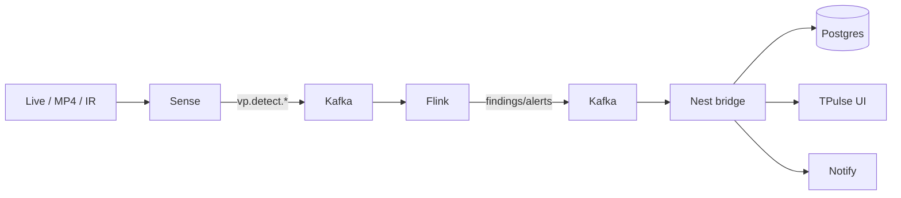

# Architecture

**Posture:** final deployed architecture. Features phase; services, contracts, storage, observability, and retrain path do not require redesign. See [`adr/0001-final-architecture-now.md`](adr/0001-final-architecture-now.md).  
**Detail:** [`tdd.md`](tdd.md) · [`observability.md`](observability.md) · [`retraining.md`](retraining.md) · [`product/frd.md`](product/frd.md)

## Principles

1. Frames stop at perception — bus carries detections + short evidence, not continuous raw video to API.
2. One inference path — live, **MP4 upload**, thermal media → same worker contracts.
3. Nest (`pulse-api`) owns state — utilities, assets, inspections, findings, alerts, labels, holds.
4. Rules emit, Nest persists — Flink severity/SLA/notify emit; Nest Kafka bridge is write authority.
5. Isolated Docker services now — single host; multi-box-ready / **hybrid Sense** profiles.
6. Evidence governed — object store; inspection-scoped / content-addressed IDs; retention tiers.
7. Observable by default — infra · model/data · AI-reasoning pillars joined by OpenTelemetry.
8. Retrain in the loop — human labels; **automatic** job triggers (volume / drift / cron) → eval gate → registry → perception reload.
9. Thermal now via public media ingest; IR camera later — same path.

## Stack (open names)

| Layer | Tech / service |
|-------|----------------|
| Stream gateway | MediaMTX-class (`pulse-gateway`) |
| Perception | DeepStream + TensorRT (`grid-perception`); ONNX fallback OK |
| **Realtime event plane** | Kafka (`pulse-bus`) + Flink (`grid-rules`) — one Compose profile: durable ordered log + continuous processing |
| Notify | Abstract adapter (`pulse-notify`) |
| Application server | NestJS (`pulse-api`) + Kafka consumer/bridge |
| Data | PostgreSQL (+ PostGIS optional), Redis optional |
| Object store | MinIO/S3 (`pulse-store`) evidence store |
| UI | React (`pulse-web` / TPulse) |
| Observability | Prometheus + Grafana · FiftyOne/Evidently · Phoenix · OTel |
| Train | ClearML + FiftyOne + CVAT (`pulse-train`) — trigger-driven CT |

Topics: `vp.detect.*`, `vp.findings.*`, `vp.alerts.*`, `vp.labels.*`, `vp.models.*`.

## Planes ↔ Compose profiles

| Profile | Services | Future host |
|---------|----------|-------------|
| `sense` | `grid-perception` | GPU / Jetson-class **or** central rack |
| `media` | `pulse-gateway`, media helpers | Stream/media box |
| `stream` | **Realtime event plane:** Kafka + `grid-rules` (Flink) | Stream-processing box (central) |
| `data` | Nest, Postgres, Redis, notify, UI | Data-plane box (central) |
| `obs` | Prometheus/Grafana + OTel (+ Evidently/Phoenix product) | With data or dedicated |
| `train` | ClearML / FiftyOne / CVAT trigger path | With data or dedicated |
| `store` | MinIO (`pulse-store`) | Shared evidence store |

## Ownership

| Owner | Writes |
|-------|--------|
| `grid-perception` | `vp.detect.*` + evidence objects |
| `grid-rules` | `vp.findings.*`, `vp.alerts.*` (emit) |
| `pulse-api` | Postgres authoritative state |
| `pulse-notify` | Channel delivery; receipts → API |
| `pulse-train` | Dataset artifacts; registry; `vp.models.*` (auto trigger + eval gate) |
| `pulse-web` | Nest only (no direct Kafka) |

## Canonical wire

```text
Sense → vp.detect.* → Kafka → Flink → vp.findings.* / vp.alerts.* → Kafka
                                              ↓
                                    Nest bridge → Postgres / notify / UI
```



**Invariant:** Nest + Postgres own findings and alerts. Edge never becomes the system of record. Continuous raw video never rides a weak uplink.
