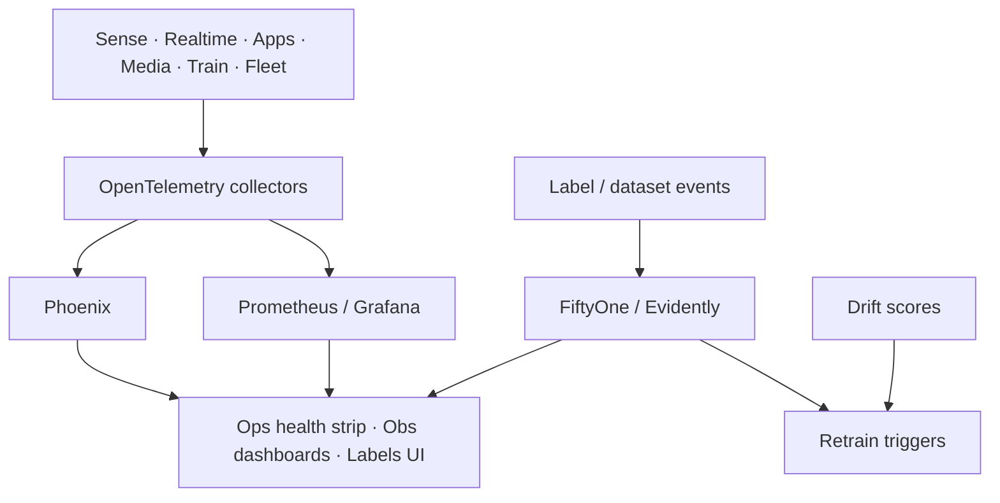

# TPulse — Observability guide

**Status:** Binding formal  
**Companions:** [`tdd.md`](tdd.md) · [`architecture.md`](architecture.md) · [`retraining.md`](retraining.md) · [`product/frd.md`](product/frd.md) (FR-M5)

Three pillars answer **what went wrong?** — joined by one OpenTelemetry trace from frame/upload → detection → finding → alert → notify.

---

## 1. Architecture

```text
                 WHAT WENT WRONG?
                       │
       ┌───────────────┼────────────────┐
       │               │                │
       ↓               ↓                ↓
  Infrastructure     Model/Data       AI Reasoning
       │               │                │
 Prometheus         FiftyOne         Phoenix
 Grafana            Evidently
       │               │                │
       └───────────────┼────────────────┘
                       ↓
                  OpenTelemetry
                       ↓
                 Unified tracing
```



---

## 2. Pillars

| Pillar | Stack | Questions | Key signals |
|--------|-------|-----------|-------------|
| **Infrastructure** | Prometheus · Grafana | Is the pipeline up / slow / lagging? | Kafka consumer lag, end-to-end latency, GPU/node health, notify success rate, stream up |
| **Model / data** | FiftyOne · Evidently | Is data or the model drifting / bad? | Per-class FP/FN, confidence drift, label coverage, hard-example clusters |
| **AI reasoning** | Phoenix | Why this class / risk / vendor hint? | Spans per finding, comparison to reviewer decision, silent regressions |
| **Join** | OpenTelemetry | One request across planes | Trace id on gateway → Sense → Kafka → Flink → Nest → notify/UI |

Phoenix is **not** the primary CV pipeline monitor. Infra covers pipes; FiftyOne/Evidently cover CV quality; Phoenix covers reasoning/VLM/agent-style spans when present.

---

## 3. Demo Day vs product

| Scope | Requirement |
|-------|-------------|
| **Demo Day minimum** | Pipeline **health strip**: lag · latency · notify success |
| **Product** | Full three pillars + OTel end-to-end · dashboards per plane · tickets on fleet failure |

---

## 4. Instrumentation map

| Plane | Export |
|-------|--------|
| Sense | Infer latency, FPS/batch, GPU util, model_version, error rate |
| Realtime | Topic lag, Flink throughput, DLQ depth, rule emit rate |
| Apps | Nest request latency, Kafka consume lag, persist errors, ack latency |
| Media | Session up, pull failures, upload bytes/errors |
| Notify | Delivery success/fail by channel |
| Train | Job duration, eval metrics, activate events |
| Fleet | Heartbeat age, package rollout status |

---

## 5. Alerting (pipeline itself)

Examples (tune later): Kafka lag > threshold · notify success < SLO · Sense error spike · DLQ growth · heartbeat missing.

Model/data alerts: drift threshold crossed → **retrain trigger** (see [`retraining.md`](retraining.md)), not only a human page.

---

## 6. References (tools)

| Tool | Role |
|------|------|
| Prometheus / Grafana | Metrics + ops dashboards |
| OpenTelemetry | Traces/metrics plumbing |
| FiftyOne | CV dataset / prediction inspection |
| Evidently | Drift / data quality reports |
| Phoenix | AI/app tracing & eval loops |

Extended research notes may live under gitignored `local-notes/observability/`; **this file is binding**.
