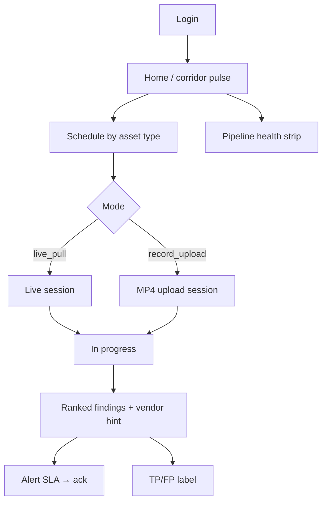

# TPulse — Functional Requirements Document (FRD)

**Status:** Binding formal  
**Product:** TPulse (Infronex · TISC Challenge 09 — Energy)  
**Packages:** `@voltpulse/*` · `pulse-*` · `grid-*` · `vp.*`  
**Companions:** [`requirements.md`](requirements.md) · [`feature-catalog.md`](feature-catalog.md) · [`../tdd.md`](../tdd.md) · [`../architecture.md`](../architecture.md)

Architecture is final. This FRD states **what** the product must do. How is in the TDD.

---

## 1. Goal

Operators schedule and run **drone / media inspections** of feeders, lines, and substations. The system:

- Detects **crack, sag, corrosion, vegetation, thermal_hotspot**
- Ranks by **severity × asset criticality**
- Alerts via **push/SMS + SLA + ack**
- Hints **vendor / responsibility**
- Stores **governed evidence**
- Supports **multi-utility RBAC**, **three-pillar observability**, and **automatic continuous training**

Sources: **live RTSP/RTMP** and **direct MP4 / public IR upload** on one Sense contract. Deploy is **hybrid** (Demo Day = central).

---

## 2. Actors & tenancy

| Role | Scope |
|------|--------|
| `platform_admin` | Utilities/orgs; ceilings; Sense deploy profiles (central \| edge) |
| `utility_admin` | Sites, assets, streams, channels, SLA, retention, users |
| `energy_supervisor` | Schedule; policy; breached SLA; vendor review; canary veto |
| `energy_operator` | Sessions; findings; ack; TP/FP labels |
| `viewer` | Read-only history / compliance |

Every operational row scoped by `utility_id` (+ optional `dept_code`). Demo may run one utility.

---

## 3. Inspection lifecycle

| API status | UI label | Meaning |
|------------|----------|---------|
| `planned` | **Scheduled** | Wizard output — not started |
| `in_progress` | **In progress** | Capture **and** perception (no separate processing status) |
| `review` | Review | Human confirms findings |
| `closed` | Closed | Work complete |
| `failed` / `cancelled` | Failed / Cancelled | Terminal |

Modes: `live_pull` \| `record_upload` · media: RGB / IR / mixed.

---

## 4. Functional requirements

### 4.1 Auth & shell

| ID | Requirement | Phase |
|----|-------------|-------|
| FR-A1 | Login (email/password or lab API key); session | P0 |
| FR-A2 | Role-gated nav | P0 |
| FR-A3 | App shell: sidebar + header (search, notifications, profile) | P0 |
| FR-A4 | Degraded realtime banner + manual refresh | P1 |
| FR-A5 | Multi-utility switcher | P1 |

### 4.2 Inspections & scheduling

| ID | Requirement | Phase |
|----|-------------|-------|
| FR-I1 | Lifecycle per §3 | P0 |
| FR-I2 | Modes live_pull \| record_upload | P0 |
| FR-I3 | Asset-type wizards (line / feeder / substation) | P0/P1 |
| FR-I4 | List filters: site, type, status, severity, date, assignee, SLA, mode, utility | P0/P1 |
| FR-I5 | Live session: preview, health, live findings, Stop | P0/P1 |
| FR-I6 | Upload session: MP4 dropzone, progress, retry, attach to inspection | P0 |
| FR-I7 | History / closed archive | P0 |

### 4.3 Findings, priority, alerts, tasks

| ID | Requirement | Phase |
|----|-------------|-------|
| FR-F1 | Five classes + confidence + evidence | P0 |
| FR-F2 | Risk = f(severity, confidence, criticality, voltage) | P0 |
| FR-F3 | Rule-template recommendations | P0 |
| FR-F4 | Finding detail: lightbox, override+audit, TP/FP, vendor/warranty hint | P0 |
| FR-F5 | Alert SLA countdown, ack, breach lane | P0 |
| FR-F6 | Task queue: assign finding/alert with due | P0/P1 |
| FR-F7 | Optional incident grouping of critical findings | P1 |
| FR-F8 | Push/SMS via abstract notify (mock OK Demo Day) | P0 |

**Illustrative SLA policy (configurable):** Critical 15m · High 1h · Medium 4h · Low next review.

### 4.4 Assets & responsibility

| ID | Requirement | Phase |
|----|-------------|-------|
| FR-R1 | Registry feeder / line / sub / span / tower | P0/P1 |
| FR-R2 | OEM, install date, warranty, anti-corrosion SLA, criticality, geo, circuit | P0/P1 |
| FR-R3 | Finding → responsible-party hint (hint, not verdict) | P1 |
| FR-R4 | CSV import dry-run + apply | P1 |
| FR-R5 | Work-order export stub | P2 |

### 4.5 Evidence & compliance

| ID | Requirement | Phase |
|----|-------------|-------|
| FR-E1 | Inspection-scoped / content-addressed objects | P0 |
| FR-E2 | Retention hot / warm / expire + legal hold | P0/P1 |
| FR-E3 | Signed URL preview + lightbox | P0 |
| FR-E4 | Compliance PDF/CSV | P1/P2 |

### 4.6 Admin, obs, ML ops

| ID | Requirement | Phase |
|----|-------------|-------|
| FR-M1 | Utility onboarding checklist | P1 |
| FR-M2 | Users & roles CRUD + dept scope | P1 |
| FR-M3 | Config: channels, severity, SLA timers, retention | P0/P1 |
| FR-M4 | Stream / drone endpoint registry | P1 |
| FR-M5 | Obs pillars — see [`../observability.md`](../observability.md) | P1 |
| FR-M6 | Platform orgs / Sense profiles (central \| edge) | P1/P2 |
| FR-M7 | Human TP/FP / wrong-class → FiftyOne (+ CVAT) | P1 |
| FR-M8 | **Automatic** retrain triggers (volume / drift / cron) → ClearML → eval gate → canary/activate; UI status | P1/P2 |
| FR-M9 | i18n locale switch | P2 |

---

## 5. Primary workflows (Demo Day)

### Acceptance spine

1. Login as utility operator.  
2. Schedule inspection → upload feeder MP4 (+ optional IR).  
3. Ranked findings; open evidence crop; vendor hint on top finding.  
4. Critical/high alert with SLA; ack stops clock.  
5. Label TP/FP into queue.  
6. Health strip shows lag · latency · notify success.  
7. Stretch: live RTSP/RTMP same Sense contract.

---

## 6. Non-functional

| Area | Requirement |
|------|-------------|
| Distinctness | TPulse brand only; no foreign chrome/strings ([`../anti-leak.md`](../anti-leak.md)) |
| SoR | Nest + Postgres own findings/alerts; edge never SoR |
| Bandwidth | Continuous raw video never on weak uplink |
| Density | Ops pages industrial; not empty shells |
| Offline demo | Explicit mock banner; writes fail loud when live intended |
| A11y | Keyboard triage on alerts; contrast on SLA breach |

---

## 7. Related

| Doc | Role |
|-----|------|
| [`../tdd.md`](../tdd.md) | Technical design + diagrams |
| [`../architecture.md`](../architecture.md) | Planes / ownership |
| [`../observability.md`](../observability.md) | Obs guide |
| [`../retraining.md`](../retraining.md) | Auto CT guide |
| [`../storage-retention.md`](../storage-retention.md) | Evidence tiers |
