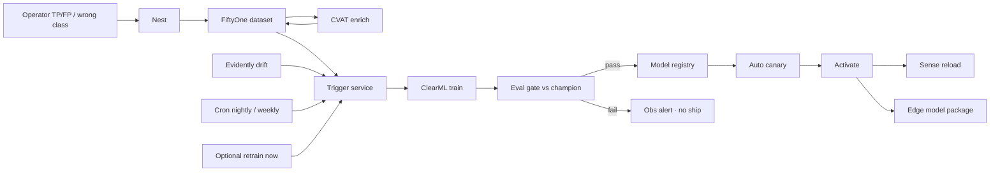

# TPulse — Training / continuous training guide

**Status:** Binding formal  
**Companions:** [`tdd.md`](tdd.md) · [`observability.md`](observability.md) · [`product/frd.md`](product/frd.md) (FR-M7, FR-M8)

**Policy:** Labels are **human**. Job **dispatch is automatic** (volume · drift · cron · optional ops override). An **eval gate** decides what ships. Supervisors may **veto** a canary — they do not own routine train starts.

---

## 1. Pipeline



```text
Human labels only
        ↓
FiftyOne (+ CVAT)
        ↓
AUTOMATIC TRIGGERS — no manual daily start
  VOLUME · DRIFT · CRON · OPS OVERRIDE
        ↓
ClearML train → Eval gate vs champion
        ↓
pass → Registry → Auto canary → Activate → Sense reload (± edge)
fail → alert, champion keeps serving
```

---

## 2. Triggers

| Trigger | Condition (tune per utility) | Typical action |
|---------|------------------------------|----------------|
| **Volume** | ≥ N new **approved** labels since last train (global or per class) | Start ClearML train |
| **Drift** | Evidently / FiftyOne drift score above threshold | Start train (or dry-run first) |
| **Cron** | Nightly dry-run · weekly promote window | Scheduled job |
| **Ops override** | Supervisor/platform “retrain now” | Immediate job — optional path |

Unapproved raw TP/FP clicks **queue** data; they do not alone force production ship.

---

## 3. Quality gate

| Step | Rule |
|------|------|
| Train | ClearML experiment + artifacts |
| Eval | Compare candidate to **champion** on held-out / recent labeled set |
| Pass | Register version → auto canary → activate Sense (central ± edge package) |
| Fail | Alert in Obs · **no ship** · champion remains live |
| Veto | Supervisor may block canary after pass if field risk |

---

## 4. Tooling roles

| Tool | Responsibility |
|------|----------------|
| **FiftyOne** | Curate hard examples, dataset versions, prediction review |
| **CVAT** | Correct / enrich boxes and classes |
| **Evidently** | Drift / data-quality signal into triggers |
| **ClearML** | Pipeline orch, experiments, artifacts, registry hooks |
| **Nest / Fleet** | Label ingest, activate policy, Sense/edge model push |
| **Obs** | Job metrics, failed eval alerts, canary health |

---

## 5. Topics & ownership

| Topic | Direction |
|-------|-----------|
| `vp.labels.*` | Nest → Train |
| `vp.models.*` | Train / Fleet → Sense |

Perception hot-swaps only after activate policy succeeds.

---

## 6. Demo Day vs product

| Scope | Requirement |
|-------|-------------|
| **Demo Day** | Label into FiftyOne path; show trigger + eval-gate **dry run** / status UI |
| **Product** | Full automatic triggers, canary, edge model packages |

---

## 7. References

Extended chat research may live under gitignored `local-notes/retraining/`; **this file is binding**.
