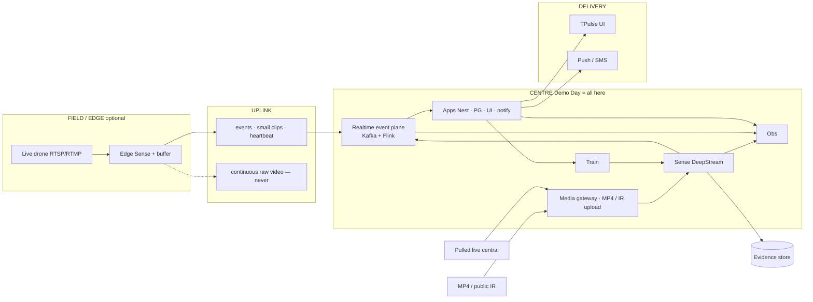
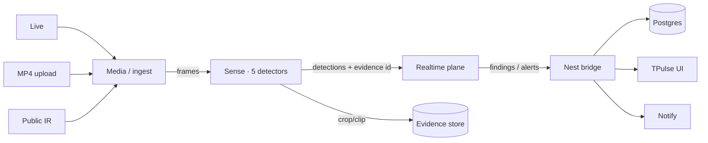
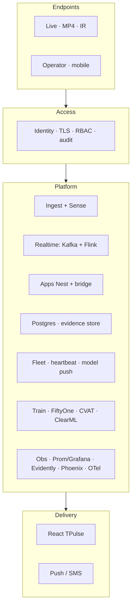

# TPulse — Technical Design Document (TDD)

**Status:** Binding formal  
**Product:** TPulse · Infronex · Challenge 09 Energy  
**Companions:** [`architecture.md`](architecture.md) · [`product/frd.md`](product/frd.md) · [`observability.md`](observability.md) · [`retraining.md`](retraining.md)

Lock **how** TPulse implements the FRD: planes, internal wires, contracts, hybrid deploy. UI module detail evolves with `pulse-web`; contracts below do not redesign.

---

## 1. Posture

- Final architecture now — features phase.  
- **Demo Day:** central Compose (one host).  
- **Product:** hybrid Sense (edge GPU *or* centre-racked); Realtime + Apps stay central.  
- **Realtime event plane:** Kafka + Flink as **one** Compose profile (`stream`).

---

## 2. Planes ↔ services

| Plane | Profile | Services |
|-------|---------|----------|
| Sense | `sense` | `grid-perception` (DeepStream / TensorRT; ONNX fallback) |
| Media | `media` | `pulse-gateway` (MediaMTX-class), upload helpers |
| **Realtime** | `stream` | Kafka (`pulse-bus`) + Flink (`grid-rules`) |
| Apps | `data` | Nest (`pulse-api` + Kafka bridge), Postgres, Redis opt., `pulse-notify`, `pulse-web` |
| Evidence | `store` | MinIO/S3 (`pulse-store`) |
| Obs | `obs` | Prometheus · Grafana · OTel (+ Evidently · Phoenix product) |
| Train | `train` | FiftyOne · CVAT · ClearML · trigger service |

Topics: `vp.detect.*` · `vp.findings.*` · `vp.alerts.*` · `vp.labels.*` · `vp.models.*`.

---

## 3. Ownership

| Owner | Writes | Must not |
|-------|--------|----------|
| `pulse-api` | Utilities, assets, inspections, findings, alerts, tasks, labels, holds, RBAC, activate policy | UI→Kafka bypass |
| `grid-rules` | Emit findings/alerts/SLA on Kafka | Direct Postgres lifecycle |
| `grid-perception` | `vp.detect.*` + evidence objects | Own alert state |
| `pulse-notify` | Delivery + receipts → Nest | Mutate alert without Nest |
| `pulse-web` | Nest REST (+ gateway preview) | Direct Kafka |
| Train plane | Datasets, jobs, registry | Ship without eval gate |

---

## 4. Deployment architecture



| Mode | Sense | Realtime + Apps |
|------|-------|-----------------|
| Demo central | Same host | Same host |
| Hybrid weak uplink | Edge GPU | Central |
| Fibre NOC | Sense racked beside Kafka | Central |

**Invariant:** Nest + Postgres are SoR. Edge never owns findings/alerts.

---

## 5. Path of one frame / one upload



| Stage | Stays | Leaves |
|-------|-------|--------|
| Media / ingest | Raw video, full-rate frames, uploaded file | Decoded frames to Sense |
| Sense | Pixels, model weights | Detections + small evidence clip |
| Realtime plane | Ordered log, DLQ, replay | Findings/alerts with risk + SLA |
| Apps | Findings, alerts, audit (SoR) | Notify payloads + UI API reads |

**Sense contract (live = upload):**  
`asset_ref · class · severity · confidence · bbox · frame_ts · source: live|upload · model_version`

---

## 6. Centre technical architecture



**Every box:** identity · audit on write · TLS · metrics/logs/traces · same images any host.

---

## 7. Internal wire (canonical)

```text
Sense ──vp.detect.*──► Kafka ──► Flink ──vp.findings.* / vp.alerts.*──► Kafka
                                              │
                                              ▼
                                    Nest Kafka bridge
                                              │
                         ┌────────────────────┼────────────────────┐
                         ▼                    ▼                    ▼
                      Postgres              Notify              pulse-web
                         │
                    vp.labels.* ──► Train triggers ──► ClearML ──► vp.models.* ──► Sense
```

Guarantees: Nest-only writes for alerts/acks · idempotent consumers on finding id · poison → DLQ · audited transitions.

---

## 8. Alert + SLA path

1. Flink emits risk + SLA → findings/alerts topics  
2. Nest bridge persists + audit  
3. Notify push/SMS (+ vendor hint)  
4. Owner ack in UI stops clock  

---

## 9. Cross-links

| Concern | Doc |
|---------|-----|
| Obs pillars | [`observability.md`](observability.md) |
| Auto CT | [`retraining.md`](retraining.md) |
| Evidence tiers | [`storage-retention.md`](storage-retention.md) |
| What / UI | [`product/frd.md`](product/frd.md) |
